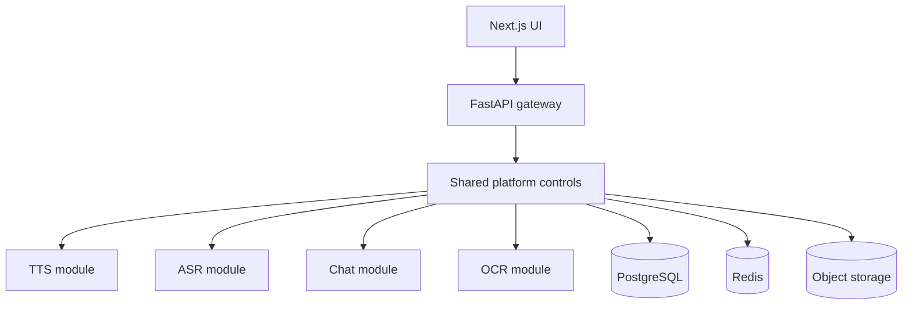

# Architecture baseline

## Module boundary

TTS, ASR, chat, and OCR are separate capability modules. Each owns its request schema, provider protocol, validation, deadlines, and result schema. They do not own identity, consent, idempotency, audit, artifact retention, or admission policy.

## Product shell and module catalogue

The web application uses a persistent workspace shell. Home, Usage and Activity History are
stable platform pages; Chat, TTS, ASR and OCR are discovered through `GET /api/v1/modules`.
Navigation order and visibility therefore come from an authorised catalogue rather than a
hard-coded sidebar. Compiled renderers remain capability-specific, while future standard-form
modules can share the catalogue contract.

Access metadata, audit evidence, saved interactions, improvement copies and experience feedback
have separate schemas and permissions. The local developer profile persists these records in
SQLite. The production target is the PostgreSQL schema in `infra/postgres/init/001_platform.sql`.
Neither store writes raw query or answer content to access/audit records.

## Initial implementation choice

The first milestone is a modular monolith. This keeps contracts explicit without imposing four independent deployment pipelines before load or team ownership justifies them. Every module is isolated behind a Python protocol and an API router, so a module can later move to a private service without changing the public API.

The live ASR socket accepts an in-band `{"type":"token_refresh","token":"..."}` control message, so an OIDC-backed deployment can renew credentials without dropping buffered audio. Development mode only checks that the replacement token is non-empty; the production identity adapter must perform issuer, audience, signature, and expiry validation.

## Production gaps still to close

The repository is an executable development baseline, not production approval. Production work includes OIDC Authorization Code + PKCE, PostgreSQL-backed application repositories, Redis-backed distributed admission with the v1.7 degradation policy, S3 artifact lifecycle, durable workers/outbox projection, malware/media validation, approved model selection, RAG, observability, and all A01–A37 acceptance evidence.
